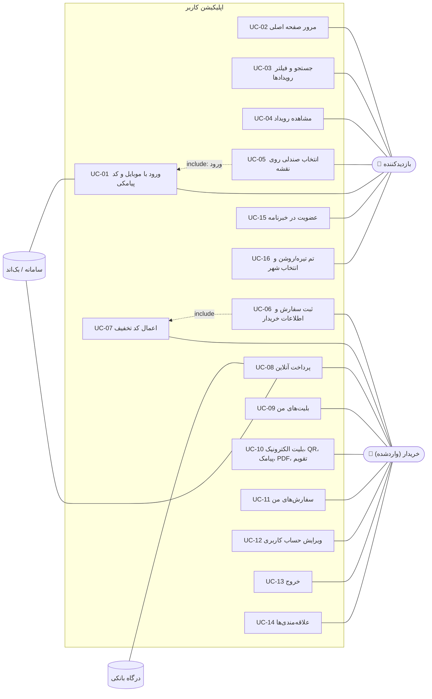
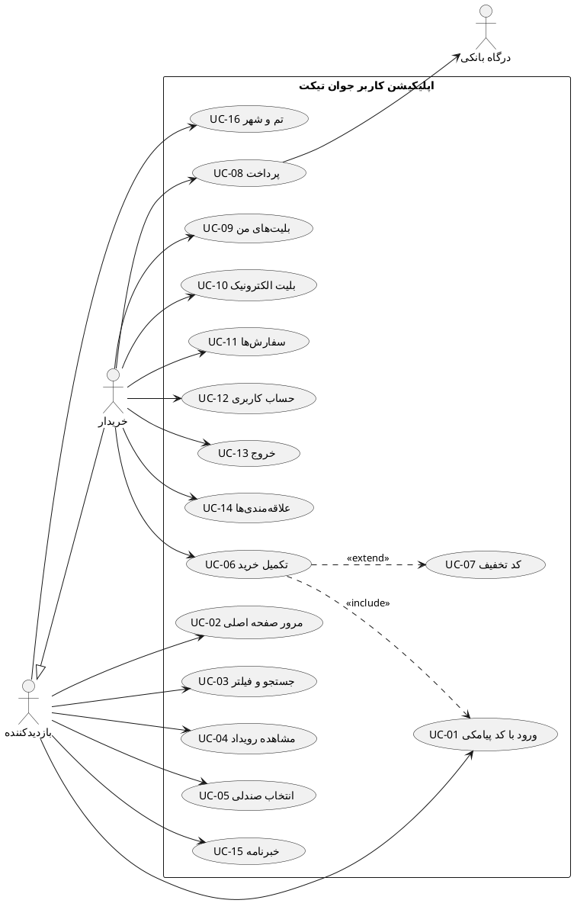

# اپلیکیشن اندروید کاربر — جوان تیکت

نسخه بومی (Native) سایت کاربر (`frontend/user`) برای اندروید: همه صفحات، همان داده‌ها از همان API، همان رنگ‌ها، فونت، آیکون‌ها و متن‌ها؛ راست‌چین، تم تیره و روشن.

## فهرست

1. [فناوری‌ها](#۱-فناوریها)
2. [معماری](#۲-معماری)
3. [نمودار موارد کاربرد (Use Case)](#۳-نمودار-موارد-کاربرد-use-case)
4. [صفحات و معادل آن‌ها در سایت](#۴-صفحات-و-معادل-آنها-در-سایت)
5. [جریان خرید و پرداخت](#۵-جریان-خرید-و-پرداخت)
6. [طراحی: رنگ، فونت، آیکون](#۶-طراحی-رنگ-فونت-آیکون)
7. [ساخت و اجرا](#۷-ساخت-و-اجرا)
8. [تست](#۸-تست)
9. [ساختار پوشه‌ها](#۹-ساختار-پوشهها)

---

## ۱. فناوری‌ها

| بخش | کتابخانه |
|---|---|
| زبان و ساخت | Kotlin 2.0، Gradle Kotlin DSL با Version Catalog (`gradle/libs.versions.toml`)، AGP 8.13 |
| رابط کاربری | Jetpack Compose (Material 3)، Navigation Compose با مسیرهای Type-safe |
| معماری | Clean Architecture + MVVM + جریان داده یک‌طرفه (UDF) با `StateFlow` |
| تزریق وابستگی | Hilt (KSP) |
| شبکه | Retrofit + OkHttp + kotlinx.serialization |
| ذخیره‌سازی | DataStore (نشست ورود جدا از تنظیمات و خارج از بک‌آپ ابری) |
| تصویر | Coil همراه با رمزگشای SVG (آیکون‌های SVG پنل مدیریت) |
| بلیت | ZXing برای ساخت QR، Print Framework برای PDF/چاپ |
| تست | JUnit، kotlinx-coroutines-test، OkHttp MockWebServer |

## ۲. معماری

سه لایه، وابستگی فقط به سمت داخل:

```
ui  ──►  domain  ◄──  data
```

| لایه | پوشه | مسئولیت |
|---|---|---|
| **domain** | `domain/model`، `domain/repository`، `domain/usecase` | مدل‌ها، قرارداد مخزن‌ها (Interface) و موارد کاربرد؛ قواعد کسب‌وکار (اعتبارسنجی فرم خریدار، وضعیت سانس، سقف ۱۰ صندلی، ساخت اسلایدها) |
| **data** | `data/remote`، `data/local`، `data/repository`، `data/di` | پیاده‌سازی مخزن‌ها با Retrofit و DataStore؛ باز کردن پاکت `{success, message, data}` و تبدیل هر خطا به پیام فارسی (`AppError`) |
| **ui** | `ui/<feature>` | برای هر صفحه یک `ViewModel` (وضعیت در `StateFlow`) و یک Composable؛ رویدادهای یک‌باره با `Channel` |
| **core** | `core/` | سامانه طراحی (تم، آیکون، کامپوننت‌ها)، قالب‌بندی فارسی (`Fa`)، خطاها |

**تصمیم‌های مهم**

- مدل‌های API همان مدل‌های دامنه‌اند (لایه DTO جدا ساخته نشده): بک‌اند دقیقاً همان شکلی را برمی‌گرداند که صفحات لازم دارند و Mapper فقط فیلدها را یک‌به‌یک کپی می‌کرد.
- **توکن**: هدر `Authorization` با `AuthInterceptor`؛ توکن منقضی با `TokenAuthenticator` یک بار تمدید و درخواست تکرار می‌شود (مثل وب)؛ اگر تمدید نشد کاربر خارج می‌شود.
- **نگهداری صندلی**: هر دستگاه یک `X-Hold-Token` ثابت دارد (`PreferencesStore`)؛ صندلی‌های انتخاب‌شده قبل از ورود هم برای همین دستگاه قفل می‌مانند و در تکمیل خرید به سفارش تبدیل می‌شوند.
- **شمارش معکوس** از `seconds_left` سرور و زمان دریافت پاسخ (`elapsedRealtime`) حساب می‌شود؛ ساعت گوشی روی آن اثر ندارد.
- **لینک‌های پنل مدیریت** (منو، بنر، دکمه‌ها) با `LinkRouter` به صفحه همان مسیر در اپ نگاشت می‌شوند؛ آدرس بیرونی در مرورگر باز می‌شود.
- **محافظ ورود**: صفحات حساب، خرید و پرداخت برای کاربر خارج‌شده به ورود می‌روند و پس از ورود به همان صفحه برمی‌گردند (مثل `RequireAuth` و `next` وب).
- همه پیام‌ها فارسی است؛ متن خطای خام سرور (غیر فارسی، HTML پراکسی) هرگز نمایش داده نمی‌شود و قطع اینترنت صفحه «اتصال برقرار نیست» را نشان می‌دهد.

## ۳. نمودار موارد کاربرد (Use Case)

هر مورد کاربرد یک کلاس در `domain/usecase` است (شماره‌ها در توضیح کلاس‌ها آمده‌اند).



نسخه PlantUML (برای ابزارهای UML):



## ۴. صفحات و معادل آن‌ها در سایت

| صفحه اپ | مسیر سایت | ViewModel |
|---|---|---|
| صفحه اصلی | `/` | `HomeViewModel` |
| رویدادها | `/events?q=&category=&city=&when=&type=&sort=` | `EventsViewModel` |
| رویداد | `/events/{slug}` | `EventDetailViewModel` |
| انتخاب صندلی | `/sessions/{id}/seats` | `SeatsViewModel` |
| تکمیل خرید | `/checkout?session=` یا `?order=` | `CheckoutViewModel` |
| پرداخت | `/payment?order=` | `PaymentViewModel` |
| درگاه (WebView) | صفحه بانک | — |
| نتیجه پرداخت | `/payment/result?id=` | `PaymentResultViewModel` |
| ورود / تأیید کد | `/login`، `/verify` | `LoginViewModel`، `VerifyViewModel` |
| بلیت‌های من / بلیت | `/tickets`، `/tickets/{id}` | `TicketsViewModel`، `TicketViewModel` |
| سفارش‌ها / سفارش | `/orders`، `/orders/{number}` | `OrdersViewModel`، `OrderViewModel` |
| حساب کاربری | `/profile` | `ProfileViewModel` |
| علاقه‌مندی‌ها | `/favorites` | `FavoritesViewModel` |
| صفحات محتوایی | `/about`، `/faq`، `/terms` ... | `ContentViewModel` |
| منو، هدر، فوتر، نوار پایین | — | `AppViewModel` |

همه متن‌ها، تصاویر، منوها و بنرها مثل سایت از پنل مدیریت می‌آیند (`AppViewModel` تنظیمات سایت، منو، دسته‌ها، شهرها و سربرگ‌ها را یک بار بار می‌کند).

## ۵. جریان خرید و پرداخت

1. **رویداد** → سانس → «انتخاب صندلی» (سالن صندلی‌دار) یا «انتخاب تعداد» (ورود عمومی).
2. **نقشه صندلی**: هر لمس یک قفل روی سرور است (`POST /holds`)؛ صندلی گرفته‌شده توسط دیگری پاسخ ۴۰۹ می‌دهد و نقشه به‌روز می‌شود؛ نقشه هر ۱۵ ثانیه تازه می‌شود. بزرگ‌نمایی با دو انگشت، دکمه‌ها یا دو ضربه.
3. **ورود** (اگر لازم باشد) و بازگشت به خرید.
4. **تکمیل خرید**: ساخت سفارش، اطلاعات خریدار با همان قواعد و پیام‌های سایت، کد تخفیف، پذیرش قوانین.
5. **پرداخت**: انتخاب درگاه؛ صفحه بانک داخل اپ (WebView) باز می‌شود. بانک خریدار را به `/payment/result?id=` سایت برمی‌گرداند؛ اپ همین آدرس را تشخیص می‌دهد و صفحه نتیجه خودش را باز می‌کند. با «بازگشت» از صفحه بانک هم وضعیت پرداخت در صفحه نتیجه بررسی می‌شود.
6. **بلیت**: QR (قابل اسکن در گیت)، دانلود PDF/چاپ، ارسال پیامک، اشتراک‌گذاری، افزودن به تقویم گوشی.

## ۶. طراحی: رنگ، فونت، آیکون

- **رنگ‌ها**: همه توکن‌های `frontend/user/src/app/globals.css` در `core/designsystem/theme/Color.kt` (روشن و تیره) با همان نام‌ها (`page`، `surface`، `ink`، `brand600` ...).
- **فونت**: IRANSans FaNum، تبدیل‌شده از فایل‌های `woff2` سایت به `ttf` (`res/font`)؛ ارقام همه‌جا فارسی‌اند. کدها (شماره سفارش، بلیت، پیگیری، کارت) مثل `font-code` سایت با فونت Monospace و ارقام لاتین نمایش داده می‌شوند.
- **آیکون‌ها**: همان ۷۲ آیکون lucide که سایت استفاده می‌کند، از بسته `lucide-react` با `tools/gen-icons.mjs` به `core/designsystem/icon/Lucide.kt` تبدیل شده‌اند (ضخامت خط قابل تنظیم، مثل نوار پایین سایت). آیکون‌های شبکه‌های اجتماعی فوتر از `SiteFooter.tsx` کپی شده‌اند.
- **فایل‌های سایت**: لوگوها، آیکون دسته‌ها و موج صفحه ورود از `frontend/user/public/assets` در `assets/web/`؛ آیکون اپ از آیکون PWA سایت.
- **راست‌چین**: کل اپ در `JavanTheme` با `LayoutDirection.Rtl`؛ شماره موبایل، تلفن و کدها با جداکننده LTR (`ltr()`) مثل `dir="ltr"` وب.

بازسازی آیکون‌ها پس از به‌روزرسانی سایت:

```bash
node android/user/tools/gen-icons.mjs frontend/user/node_modules/lucide-react/dist/esm \
     android/user/app/src/main/java/com/devs/nisha_user/core/designsystem/icon/Lucide.kt
```

(برای افزودن آیکون جدید، نام آن را در فهرست `NAMES` در همان اسکریپت اضافه کنید.)

## ۷. ساخت و اجرا

پیش‌نیاز: JDK 17 و Android SDK 36.

```bash
cd android/user
./gradlew :app:assembleDebug        # app/build/outputs/apk/debug/app-debug.apk
./gradlew :app:assembleRelease      # با آدرس سرور (minify + shrink)
```

**آدرس سرور**

| نسخه | آدرس پیش‌فرض API | تغییر در `local.properties` |
|---|---|---|
| Debug | `http://localhost:8081/api/v1` | `javan.apiBaseUrl=...` و `javan.siteUrl=...` |
| Release | `http://45.156.186.169:8081/api/v1` | `javan.apiBaseUrl.release=...` و `javan.siteUrl.release=...` |

اجرا روی گوشی متصل با USB و بک‌اند روی کامپیوتر:

```bash
adb reverse tcp:8081 tcp:8081
adb install -r app/build/outputs/apk/debug/app-debug.apk
```

(در شبیه‌ساز می‌توان `javan.apiBaseUrl=http://10.0.2.2:8081/api/v1` گذاشت یا همان `adb reverse` را زد.)

**حساب نمایشی**: موبایل `09121234567`، کد `1111` (وقتی کلید پیامک تنظیم نشده). درگاه آزمایشی با `PAYMENT_MODE=dev` بک‌اند فعال است.

## ۸. تست

```bash
./gradlew :app:testDebugUnitTest
```

| تست | چه چیزی |
|---|---|
| `LinkRouterTest` | نگاشت لینک‌های سایت به صفحات اپ، نامک فارسی، امنیت `next` |
| `DomainRulesTest` | نرمال‌سازی موبایل، ارقام، اعتبارسنجی فرم خریدار، وضعیت سانس، اسلایدها، پیام‌های خطا |
| `ApiCallTest` | لایه داده با JSON واقعی بک‌اند: پاکت پاسخ، ۴۰۹، خطای فیلدها، صفحه HTML پراکسی |

## ۹. ساختار پوشه‌ها

```
app/src/main/java/com/devs/nisha_user/
├── JavanApp.kt / MainActivity.kt   ← Hilt، Coil، Splash، Edge-to-edge، تم
├── core/
│   ├── common/          ← AppError (پیام فارسی)، Async
│   ├── format/          ← Fa: تاریخ شمسی، ارقام، قیمت، موبایل، ltr()
│   └── designsystem/    ← theme (رنگ، فونت، شکل)، icon (lucide)، component
├── domain/
│   ├── model/           ← مدل‌های محتوا، رویداد، سفارش، کاربر
│   ├── repository/      ← قرارداد مخزن‌ها
│   └── usecase/         ← UC-01 … UC-16
├── data/
│   ├── remote/          ← Retrofit API، ApiCall، Interceptorها، تمدید توکن
│   ├── local/           ← SessionStore، PreferencesStore (DataStore)
│   ├── repository/      ← پیاده‌سازی مخزن‌ها
│   └── di/              ← ماژول‌های Hilt
└── ui/
    ├── app/             ← AppViewModel، ریشه و ناوبری، هدر، منو، فوتر، نوار پایین
    ├── navigation/      ← مسیرها (Routes) و LinkRouter
    ├── common/          ← کارت رویداد، خلاصه سفارش، وضعیت‌ها
    ├── home/ events/ eventdetail/ seats/ checkout/ payment/
    ├── auth/ tickets/ account/
```
